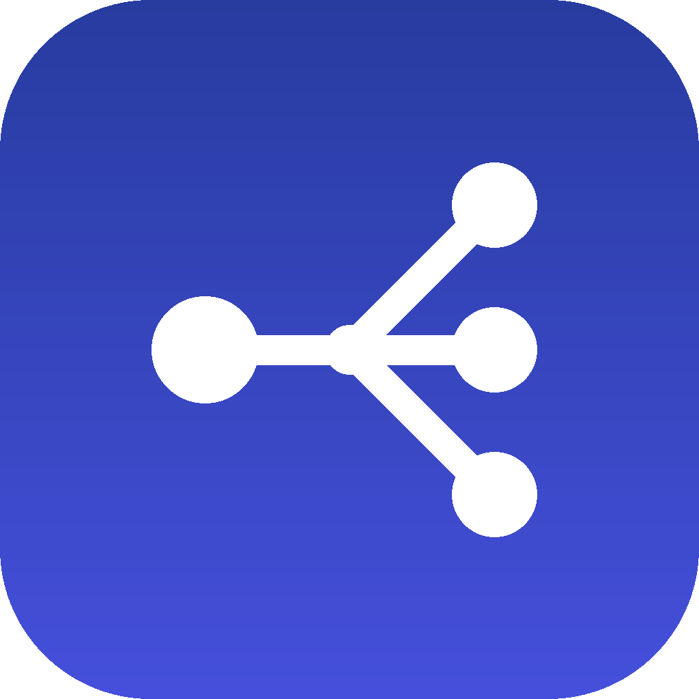

<div align="center">



# OpenRouter pour Claude Code

**Donnez à Claude l'accès à tous les modèles d'[OpenRouter](https://openrouter.ai) : texte, vision, images, voix, transcription, musique, vidéo et embeddings, avec une seule clé API.**

[English](README.md) · [Français](README.fr.md)

</div>

---

> La version anglaise ([README.md](README.md)) fait référence. Ce document en reprend l'essentiel.

## Pourquoi

Claude excelle en raisonnement et en code, mais certaines tâches demandent un autre modèle : générer une image, lire un texte à voix haute, transcrire une réunion, composer un jingle, produire une courte vidéo ou demander un deuxième avis à GPT ou Gemini. OpenRouter réunit plusieurs centaines de ces modèles derrière une seule API. Ce plugin branche cette API dans Claude Code sous forme de serveur [MCP]. Il suffit de demander, et Claude choisit le bon modèle et le bon outil.

[MCP]: https://modelcontextprotocol.io

## Fonctionnalités

| Domaine | Outil | Points forts |
| --- | --- | --- |
| 💬 Texte et vision | `chat` | Tous les modèles de chat. Pièces jointes : images, audio, vidéo, PDF, liens YouTube |
| 🖼️ Images | `generate_image` | Génération et retouche à partir d'images de référence. Ratio, résolution, qualité, fond transparent, SVG |
| 🗣️ Synthèse vocale | `text_to_speech` | Choix de la voix, consignes de ton, dialogue multi-voix, clonage de voix. Fichier mp3 ou wav |
| 📝 Transcription | `transcribe` | Fichier ou URL, langue, horodatage, identification des locuteurs, termes clés |
| 🎵 Musique et audio parlé | `generate_audio` | Musique avec Google Lyria, réponses parlées avec GPT Audio |
| 🎬 Vidéo | `generate_video`, `video_status` | Texte → vidéo, première/dernière image, images de référence. Tâches asynchrones, téléchargement mp4 |
| 🧮 Embeddings | `embeddings` | Vecteurs écrits dans un fichier JSON |
| 🔎 Découverte | `list_models`, `model_details` | Filtre par modalité. Voix, paramètres acceptés, prix et capacités par fournisseur |
| 💳 Compte | `credits` | Solde restant |

Plus la commande `/openrouter:ask [modèle] <question>` pour un deuxième avis rapide.

La référence complète des paramètres est dans **[docs/tools.md](docs/tools.md)** (en anglais, générée depuis le code).

## Prérequis

- [Claude Code](https://code.claude.com) avec la prise en charge des plugins
- [Node.js](https://nodejs.org) **18.17 ou plus récent**
- Une [clé API OpenRouter](https://openrouter.ai/keys)

## Installation

1. Exportez la clé dans le shell qui lance Claude Code (ajoutez-la à `~/.zshrc` ou `~/.bashrc` pour qu'elle soit permanente) :

   ```bash
   export OPENROUTER_API_KEY="sk-or-v1-…"
   ```

   > [!TIP]
   > Créez une clé dédiée avec une **limite de crédit** dans le tableau de bord OpenRouter. Elle plafonne ce que Claude peut dépenser.

2. Dans Claude Code :

   ```text
   /plugin marketplace add hdg-zero/claude-plugin-openrouter
   /plugin install openrouter@openrouter-marketplace
   ```

   Ou en une seule commande depuis le terminal (Claude Code 2.1.275 ou plus récent) :

   ```bash
   claude plugin install openrouter --marketplace hdg-zero/claude-plugin-openrouter
   ```

3. Redémarrez Claude Code si demandé, puis lancez `/mcp` : le serveur `openrouter` doit apparaître comme connecté.

Depuis un clone local : `/plugin marketplace add ./claude-plugin-openrouter`.

## Configuration

| Variable | Défaut | Rôle |
| --- | --- | --- |
| `OPENROUTER_API_KEY` | — **(obligatoire)** | Clé API OpenRouter |
| `OPENROUTER_DEFAULT_MODEL` | `openrouter/auto` | Modèle utilisé par `chat` si aucun n'est précisé |
| `OPENROUTER_OUTPUT_DIR` | `./openrouter-output` | Dossier des fichiers générés (relatif au projet) |
| `OPENROUTER_BASE_URL` | `https://openrouter.ai/api/v1` | Passerelle ou proxy compatible |
| `OPENROUTER_APP_TITLE` | `Claude Code OpenRouter plugin` | Nom envoyé dans l'en-tête `X-Title` |

Pensez à ajouter `openrouter-output/` au `.gitignore` de vos projets.

## Utilisation

```text
> Génère une image 16:9 d'un phare au coucher du soleil, haute qualité
> Lis ce paragraphe d'une voix chaleureuse et enregistre-le en mp3
> Transcris reunion.m4a en identifiant les locuteurs
> Compose 30 secondes de jazz calme pour l'intro de ma vidéo
> Fais une vidéo de 5 s en 9:16 qui part de photo.png
> Quels modèles de synthèse vocale gratuits sont disponibles ?
```

Sans modèle précisé, Claude appelle `list_models` avec la bonne modalité (`text`, `image`, `speech`, `transcription`, `audio`, `video`, `embeddings`), puis `model_details` pour vérifier voix, tailles, durées et prix. Les variantes gratuites se terminent par `:free`.

## Coûts et limites

- Chaque appel est facturé sur votre compte OpenRouter. Le coût est affiché quand l'API le fournit.
- **La vidéo peut coûter cher** (souvent facturée à la seconde) : consultez `model_details` avant de lancer.
- Certaines modalités exigent un solde minimum (par exemple la transcription). En dessous, l'appel échoue avec une erreur `402`.
- `generate_video` attend au plus 280 s, puis renvoie un identifiant à reprendre avec `video_status`.

## Confidentialité et sécurité

- La clé est lue uniquement depuis l'environnement. Elle n'est jamais écrite sur disque ni renvoyée dans les résultats.
- **Les pièces jointes sont envoyées à OpenRouter** et au fournisseur du modèle. N'envoyez pas de fichiers que vous n'avez pas le droit de partager.
- Pour signaler une faille, voir [SECURITY.md](SECURITY.md).

## Dépannage

| Symptôme | Solution |
| --- | --- |
| `OPENROUTER_API_KEY is not set` | Exportez la clé **avant** de lancer Claude Code, puis redémarrez-le |
| Serveur absent de `/mcp` | Vérifiez `node --version` (≥ 18.17) |
| `OpenRouter 402` | Crédit insuffisant, ou sous le solde minimum de la modalité |
| `OpenRouter 400` en synthèse vocale | Le modèle exige une `voice` (voir `model_details`) ou un seul format |
| Vidéo toujours `in_progress` | Demandez à Claude de revérifier plus tard (`video_status`) |

## Développement

```bash
npm test             # tests (sans réseau ni clé)
npm run docs         # régénère docs/tools.md
npm run check        # ce que lance la CI
claude plugin validate .
```

Voir [CONTRIBUTING.md](CONTRIBUTING.md), [docs/architecture.md](docs/architecture.md) et [docs/publishing.md](docs/publishing.md).

## Licence

[MIT](LICENSE) © hdg-zero

<sub>Projet communautaire, non affilié à OpenRouter ni à Anthropic. « OpenRouter » et « Claude » sont des marques de leurs propriétaires respectifs.</sub>
