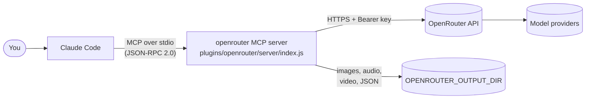

# Architecture

This document explains how the plugin is put together, for contributors and reviewers.

## Overview

1. Claude Code reads `plugins/openrouter/.mcp.json` and starts `node server/index.js`, passing the configuration through environment variables (`${OPENROUTER_API_KEY:-}` expands to an empty string when unset, so the server can report a clear error instead of failing to start).
2. The server answers `initialize` and `tools/list`, then handles `tools/call` requests.
3. Each tool maps to one OpenRouter endpoint, converts local files to the format the API expects, and saves binary results to disk.

## The plugin package

| File | Role |
| --- | --- |
| `.claude-plugin/marketplace.json` | Marketplace manifest. Lets users run `/plugin marketplace add <repo>` |
| `plugins/openrouter/.claude-plugin/plugin.json` | Plugin manifest: name, version (single source of truth), icon |
| `plugins/openrouter/.mcp.json` | Declares the MCP server and its environment |
| `plugins/openrouter/commands/ask.md` | The `/openrouter:ask` slash command (a prompt template using `$ARGUMENTS`) |
| `plugins/openrouter/server/index.js` | The MCP server |

## The MCP server

A single dependency-free CommonJS file, organised in four parts:

1. **Tool schemas (`TOOLS`).** JSON Schemas that Claude sees. Descriptions are written for the model: they say when to use the tool and point to the discovery tools. `docs/tools.md` is generated from them.
2. **Helpers.** HTTP requests with timeout and error normalisation (`ApiError` keeps the HTTP status), media loading (local path or URL → base64 / data URL), output file naming, audio sniffing and PCM → WAV wrapping.
3. **Handlers.** One async function per tool. A handler returns either a string or an array of MCP content items (text and inline images).
4. **JSON-RPC plumbing.** Line-delimited JSON over stdio. Notifications get no reply; tool errors are returned as `isError: true` results so Claude can react, while protocol errors use JSON-RPC error codes.

The module only starts reading stdin when run directly, and exports `TOOLS` and `VERSION` for the docs generator and tests.

## Endpoint mapping

| Tool | Endpoint | Notes |
| --- | --- | --- |
| `chat` | `POST /chat/completions` | Attachments become `image_url`, `input_audio`, `video_url` or `file` content parts |
| `generate_image` | `POST /images` | Response `data[].b64_json` + `media_type` |
| `text_to_speech` | `POST /audio/speech` | Raw audio bytes; pcm is 16-bit LE mono at 24 kHz |
| `transcribe` | `POST /audio/transcriptions` | JSON body with base64 `input_audio` or a URL |
| `generate_audio` | `POST /chat/completions` with `modalities: ["text","audio"]`, `stream: true` | Server-sent events carrying `delta.audio.data` chunks |
| `generate_video` / `video_status` | `POST /videos`, `GET /videos/{id}`, `GET /videos/{id}/content?index=n` | Asynchronous: submit, poll every 5 s, download |
| `embeddings` | `POST /embeddings` | |
| `list_models` | `GET /models?output_modalities=…&input_modalities=…&q=…` | Public endpoint |
| `model_details` | `GET /models/{id}/endpoints`, `GET /images/models/{id}/endpoints`, `GET /videos/models` | Public endpoints, merged |
| `credits` | `GET /credits` | |

## Design decisions

- **Zero dependencies.** Plugins are installed by cloning a repository; nothing runs `npm install`. Node 18+ provides `fetch`, web streams and `node:test`, which is all we need. The MCP protocol surface used here (initialize, tools) is small enough to implement directly.
- **Files on disk, paths in results.** Media can be large; returning paths keeps the conversation light and lets Claude use the files in the project. Images are also returned inline (up to 3 MB) so Claude can see what it generated.
- **Graceful fallbacks.** Speech retries in pcm when a model rejects mp3 and the caller did not force a format; transcription retries without timestamps when a model rejects `verbose_json`. Both are visible in the output.
- **Discovery before spending.** `model_details` surfaces voices, accepted values and prices so Claude can choose valid parameters instead of trial and error on paid endpoints.
- **Bounded waits.** Video polling stops before typical MCP client timeouts and hands back a job id.

## Testing strategy

`test/server.test.js` spawns the real server and points it at a fake OpenRouter API (`test/helpers.js`) through `OPENROUTER_BASE_URL`. Each test asserts both the request sent to OpenRouter (shape and parameters, taken from the official API reference) and the result returned to Claude. `test/manifests.test.js` checks manifest consistency, the changelog entry, the icon and the absence of committed secrets. CI also verifies that `docs/tools.md` is up to date.
